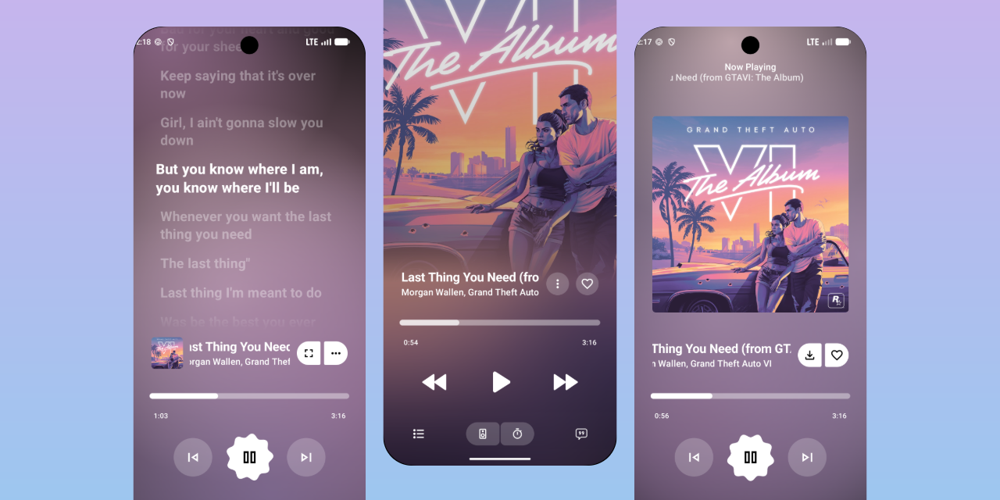
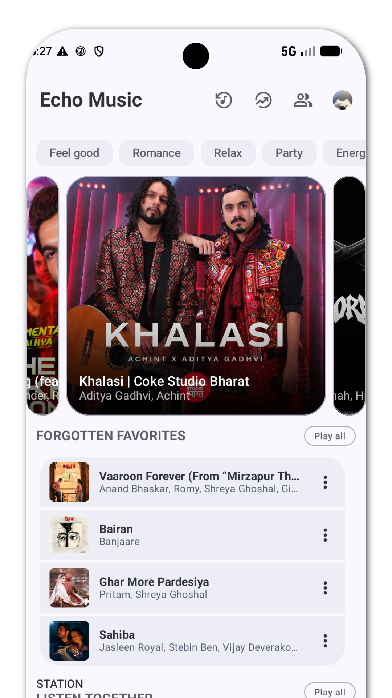
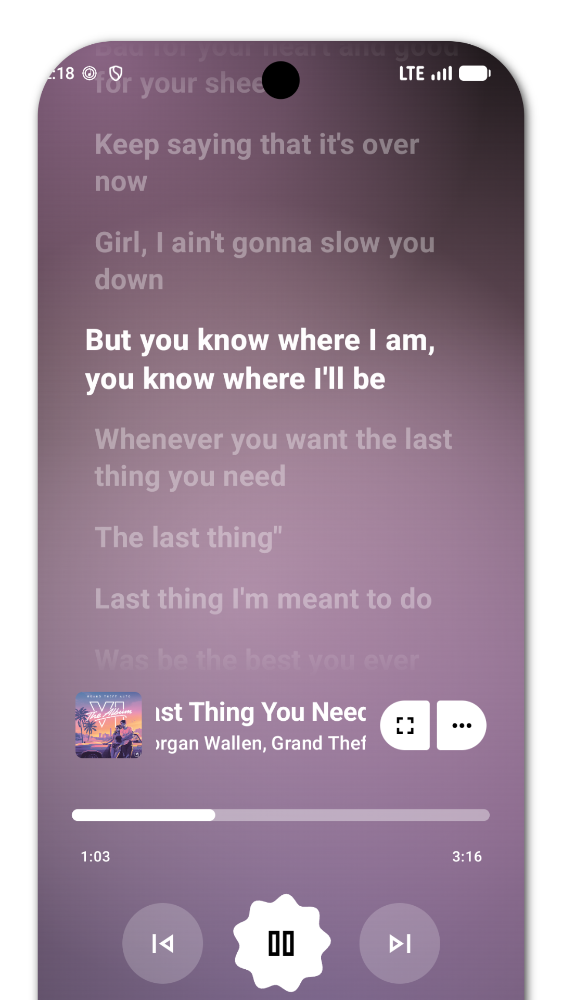
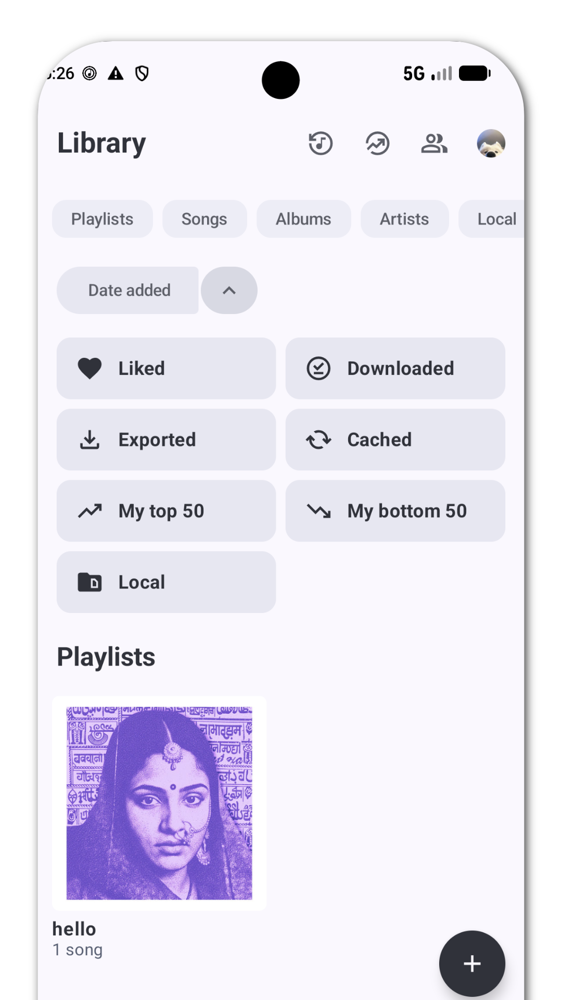

<div align="center">
  

  <h1>AshTunes</h1>
  <p><b>A modern Android music streaming client with Hi-Res Lossless FLAC playback, extensible provider architecture, Material 3 UI, and synchronized word-by-word lyrics.</b></p>

  <p>
    <a href="[https://github.com/Xorashrin/AshTunes/actions](https://github.com/Xorashrin/AshTunes/actions)"></a>
    <a href="[https://github.com/Xorashrin/AshTunes/releases/latest](https://github.com/Xorashrin/AshTunes/releases/latest)"></a>
    <a href="LICENSE"></a>
    <a href="[https://github.com/Xorashrin/AshTunes/stargazers](https://github.com/Xorashrin/AshTunes/stargazers)"></a>
  </p>
</div>

---

## Overview

**AshTunes** (developed by **Asraful Islam / Mythbrix**) is a next-generation Android music player engineered for audiophiles and everyday listeners alike. Combining an expressive Material 3 interface with a modular extension architecture and Hi-Res Lossless FLAC audio pipeline, AshTunes delivers ad-free streaming, offline playback, real-time word-synced lyrics, and intelligent music discovery.

---

## Table of Contents

- [Overview](#overview)
- [Screenshots](#screenshots)
- [Key Features](#key-features)
- [Hi-Res Lossless & Extension Architecture](#hi-res-lossless--extension-architecture)
- [Installation & Build Instructions](#installation--build-instructions)
- [Credits & Acknowledgments](#credits--acknowledgments)
- [License](#license)

---

## Screenshots

<div align="center">
  <table style="margin: 0 auto; border-collapse: collapse;">
    <tr>
      <td align="center" style="padding: 15px; border: none;">
        <b>Home Screen</b><br><br>
        
      </td>
      <td align="center" style="padding: 15px; border: none;">
        <b>Material 3 Player</b><br><br>
        
      </td>
      <td align="center" style="padding: 15px; border: none;">
        <b>Apple-Inspired Player</b><br><br>
        
      </td>
    </tr>
    <tr>
      <td align="center" style="padding: 15px; border: none;">
        <b>Synchronized Lyrics</b><br><br>
        
      </td>
      <td align="center" style="padding: 15px; border: none;">
        <b>Search & Explore</b><br><br>
        
      </td>
      <td align="center" style="padding: 15px; border: none;">
        <b>Music Library</b><br><br>
        
      </td>
    </tr>
  </table>
</div>

---

## Key Features

### Material 3 UI & Experience
- **Dynamic Material You Theming**: Adaptive color palettes extracted directly from album artwork and system wallpaper.
- **Dual Player Aesthetics**: Switch seamlessly between expressive Material 3 and Apple Music-inspired player layouts.
- **Fluid Animations & High Refresh Rate**: GPU-accelerated lyric rendering and Material 3 emphasized easing at up to 120Hz+.
- **Customizable Density & Layout**: Configurable UI density scale, album art cropping, thumbnail toggles, and feed filters.

### Audio & Playback
- **Hi-Res Lossless FLAC Support**: Direct decoding and bit-perfect capable playback for 16-bit/24-bit FLAC streams and local files.
- **Ad-Free Streaming & Offline Mode**: Uninterrupted background streaming plus a dedicated download manager for offline tracks, albums, and playlists.
- **Crossfade & Gapless Playback**: Smooth transitions between tracks with configurable crossfade curves and gapless album playback.
- **Smart Playback Controls**: Auto-pause on device mute, automatic resume on Bluetooth reconnection, and Data Saver presets.

### Lyrics & Discovery
- **Word-by-Word Synchronized Lyrics**: Multi-source lyric aggregation (`YouLyPlus`, `KuGou`, `SimpMusic`, `LrcLib`) with syllable-level timing and AI translation.
- **Audio Recognition**: Built-in `ShazamKit` integration to identify songs playing around you in real time.
- **Music DNA & Smart Queue**: Track backstory annotations via Genius/Wikipedia and on-device momentum analysis for smart queue recommendations.

---

## Hi-Res Lossless & Extension Architecture

AshTunes is built around a decoupled, modular multi-module architecture that separates UI state from media extraction and decoding:

1. **Hi-Res Lossless Audio Pipeline**:
   - Powered by ExoPlayer / Media3 with custom FLAC and FFmpeg renderers.
   - Supports high-bitrate 24-bit/96kHz+ lossless FLAC streams alongside adaptive Opus/AAC streams.
   - Preserves dynamic range with optional replay-gain normalization and hardware-accelerated audio offloading.

2. **Modular Extension & Provider System**:
   - **Core Streaming & Fallback**: Primary inner-tube extraction paired with `BravePipe` decryption and fallback resolvers.
   - **Lyrics Providers**: Pluggable modules (`:kugou`, `:youlyplus`, `:simpmusic`) query multiple endpoints concurrently for the highest-accuracy synced lyrics.
   - **Recognition & Sync**: Dedicated `:shazamkit` module for acoustic fingerprinting and `:unison` for cross-device session continuity.

---

## Installation & Build Instructions

### Pre-compiled Releases
Download the latest APK from the [GitHub Releases](https://github.com/Xorashrin/AshTunes/releases/latest) page.

### Building from Source

1. **Clone the Repository**
   ```bash
   git clone https://github.com/Xorashrin/AshTunes.git
   cd AshTunes
   ```

2. **Configure Android SDK**
   Ensure **JDK 17+** and **Android SDK (API 34/35)** are installed. Create `local.properties` in the project root:
   ```bash
   echo "sdk.dir=/path/to/your/android/sdk" > local.properties
   ```

3. **Build Debug APK**
   ```bash
   ./gradlew assembleUniversalGmsDebug
   ```
   Or build the Foss/Fdroid variant without GMS dependencies:
   ```bash
   ./gradlew assembleUniversalFossDebug
   ```

4. **Build Release APK**
   ```bash
   ./gradlew assembleRelease
   ```

---

## Credits & Acknowledgments

- **Author & Lead Developer**: **Asraful Islam ([Mythbrix / Xorashrin](https://github.com/Xorashrin))**
- **Upstream & Open-Source Acknowledgments**: Built upon the foundations of Echo Music, Metrolist, ArchiveTune, Better Lyrics, SimpMusic, and BravePipe.

---

## License

<div align="center">
  <p>Copyright © Asraful Islam (Mythbrix). Licensed under the <a href="LICENSE">GNU General Public License v3.0 (GPL-3.0)</a>.</p>
</div>
